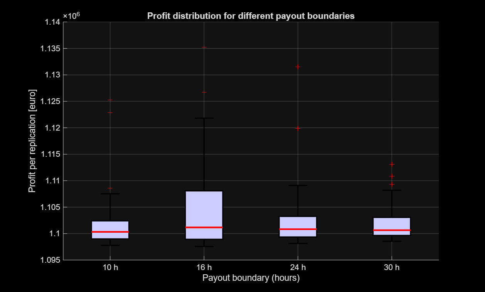

# Simulation and statistics in MATLAB

My individual assignment for the course Simulation and Statistical Analysis at Maastricht University (November 2025). Three tasks, written in plain MATLAB without toolboxes: a random number generator with a statistical test, cleaning a heart rhythm recording, and a discrete event simulation of a production plant.

This is university coursework. The repository holds my own code and the figure it produced. The assignment text and the course data file are not included.

## Task 1: random number generator and poker test

`PCG_SSA.m` is one step of a permuted congruential generator: a 32-bit linear congruential generator whose three highest bits decide how many low bits are dropped, giving a 16-bit output. `RNG_PCG.m` calls it repeatedly and scales the output to U[0,1).

`pokerCounts.m` splits the numbers into hands of five digits and counts the seven poker patterns (all different, one pair, two pairs, three of a kind, full house, four of a kind, five of a kind). `pokerChi2.m` compares the counts with the expected ones in a chi-square test. It uses `chi2inv` if the toolbox is there and otherwise finds the critical value by bisection on the incomplete gamma function.

Result for 10,000 numbers with seed 19: the test statistic is 0.69 against a critical value of 16.81 (alpha 0.01), so the generator passes.

Run `task1`.

## Task 2: cleaning RR intervals

`task2.m` loads 5,160 RR intervals (the time between two heartbeats) from a Holter ECG recording. The beats were found by simple thresholding, so the series contains missed beats (very long intervals) and noise picked up as beats (very short ones).

The script removes non-positive values and everything outside the Tukey fences (1.5 times the interquartile range beyond the quartiles). That drops 800 intervals, 15.5% of the data. The median barely moves (0.825 s to 0.83 s) while the standard deviation falls from 0.90 s to 0.27 s, so the normal rhythm stays and the detection errors go.

Before and after are shown in five views: time series, histogram, box plot (drawn by hand, no toolbox), Poincaré plot and empirical distribution function.

The data file `dataTask2.mat` was provided by the course and is not in this repository, so `task2` needs your own vector `RR` of intervals in seconds saved under that name.

## Task 3: discrete event simulation

`DES.m` simulates a plant with three machines as an M/M/3 queue:

- A machine goes into maintenance after 200 hours of active work, for 20 hours. A job that is running at that moment goes back to the front of the queue.
- A new order goes to the machine that has been idle the longest.
- An order earns 25 euro if it is finished within the payout boundary (24 hours by default) and 10 euro otherwise. Production costs 1,000 euro per hour.
- The run ends at the end of the busy period in which order 50,000 is finished.

`task3.m` runs 20 replications. On average an order spends 2.2 minutes in the system, 9.3 orders are waiting, and the profit is about 1.10 million euro. It then repeats the runs for payout boundaries of 10, 16, 24 and 30 hours:

Orders are finished within minutes, far below every boundary, so the boundary makes practically no difference to the profit; the spread between runs comes from the random arrivals and service times.

`arrival.m` and `service.m` (exponential inter-arrival and service times, four lines each) were provided by the course.

Run `task3`. It takes a few minutes.

## Requirements

MATLAB R2019b or newer (the plots use `tiledlayout`). No toolboxes needed.
